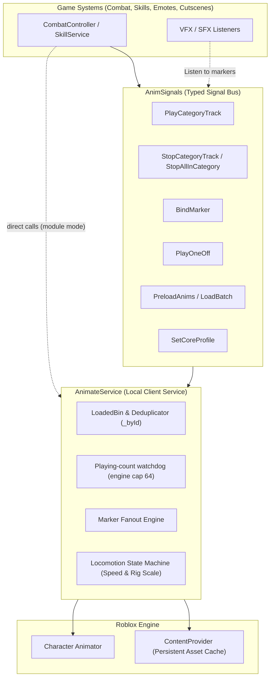
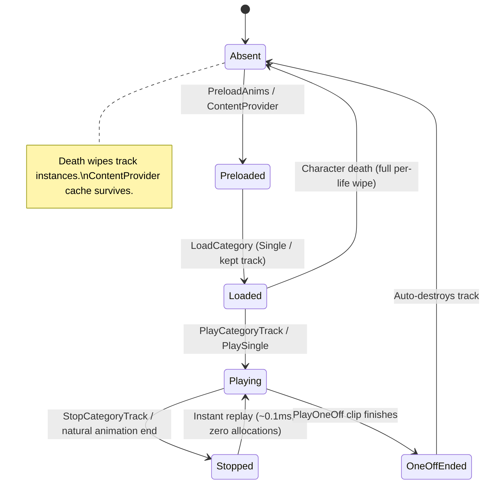
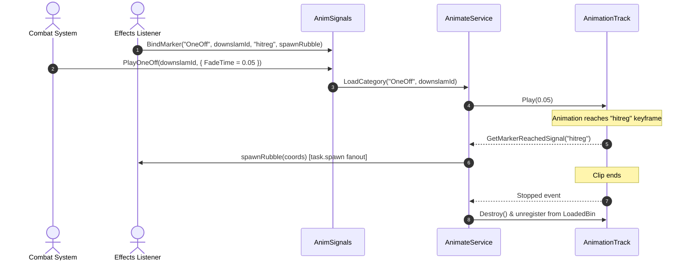
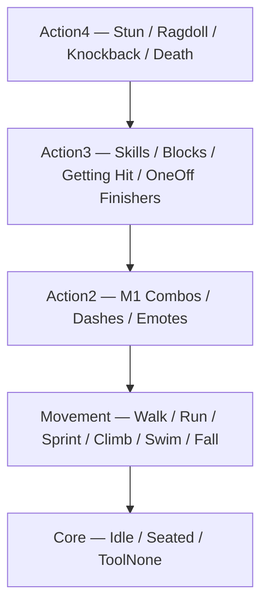

# Animation System — AnimateService + AnimSignals

> Drop-in replacement for Roblox's default `Animate` script, also usable as a
> plain module. This folder is the whole package: `Module/` (the engine),
> `Services/` (a one-file launcher), `Libraries/`, `Tests/`, and this file.
> Fire signals, or `require` it and call it directly. Dependencies: `Libraries/Signal`
> (SignalPlus, vendored, MIT) and, for the signal bus, `Libraries/AnimSignals`.
> Both are included.

---

## 0. Install (60 seconds)

1. Copy `Module/`, `Services/` and `Libraries/` into your game's
   `StarterPlayerScripts`, keeping the shape (`Module/AnimateService`,
   `Services/AnimateService`, `Libraries/AnimSignals`). Driving it from your
   own module loader instead? Skip `Services/` and read Section 6.
2. Delete or disable Roblox's default `Animate` script in
   `StarterPlayer > StarterCharacterScripts` (an empty `Animate` LocalScript
   suppresses it).
3. (Optional) Give it locomotion: add an `R15Animations` and/or
   `R6Animations` folder as children of the `Services/AnimateService` script, each
   holding `Animation` objects named per slot (`Idle`, `Walk`, `Run`,
   `Sprint`, `Jump`, `Fall`, `Climb`, `Swim`, `SwimIdle`, `Sit`). Stock-style
   `StringValue` slots work too. No folders at all is fine — the service runs
   combat-only and every Single still loads by asset id.
4. Copy `Tests/` next to `Services/` and toggle each test's `Disabled` to run
   them one at a time (Section 9).

---

## 1. What this is

Stock Roblox `Animate` was built for Obbies in 2014, not high-speed anime combat. If you try running a battlegrounds game on default `Animate`, your combos hitch on first swing, your `LoadAnimation` calls pile up, and your character's arms fight their legs when blocking mid-sprint.

This service completely takes over character animation. Everything else in your game — combat systems, skill movesets, emote wheels, cutscenes, downslams — talks to it through a typed signal bus (`AnimSignals`). No other script ever touches `Animator:LoadAnimation()` directly.

| The Stock `Animate` Trap | How `AnimateService` Solves It |
| :--- | :--- |
| **Blind `LoadAnimation` every swing** (a bunch of leaks animation tracks) | **`LoadedBin` registry**: every track indexed by clean ID and reused; kept Singles stay loaded until the character dies, OneOffs unload themselves |
| **First-play frame hitch** (waiting on asset fetch mid-combo) | **System-side `PreloadAsync`**: preloads asset data so first play and replays dispatch in ~0.1ms |
| **Marker callbacks dropped on cache hit** | **Marker fanout**: multiple systems can listen to `Hit` / `CanCancel` on the same track; survives reuse |
| **Zero clean stop path for combat** | **`StopCategoryTrack` & `StopAllInCategory`**: feints, interrupts, and stuns cancel tracks cleanly with custom fades |
| **Track instances leak across lives** | **Per-life lifecycle**: old tracks destroyed on death; asset cache stays warm in memory |
| **Locomotion stomps combat arms** | **Caller-typed priority**: every load takes `Priority: Enum.AnimationPriority?`, system defaults `Core`; pass what each move needs, or enable `ClampCombatPriority` to force combat tracks to `Action2`+ |
| **Default `Animate` fights custom scripts** | **Instant suppression**: empty `StarterCharacterScripts/Animate.local.luau` kills stock Roblox `Animate` at the root |

### Battle-Tested Benchmarks (Measured live in Play Solo on our game — your counts follow your folders)

- **Initial Core Count:** Exactly 10 tracks loaded on spawn (our 10-slot core).
- **Zero Leak on Respawn:** Rebuilds 10 tracks on death. Never 20, never 38.
- **Cache Hit Overhead:** Cold asset fetch takes **~125.9ms**; preloaded dispatch takes **~0.1ms**.
- **Track Reuse:** Calling `PlayCategoryTrack` on an already-loaded ID stays flat (`10 -> 11 -> 11`). No duplicate track instances created.
- **Clean Death:** Stashed old track references have `Parent == nil` post-respawn; calling `Play()` on them is safely handled.

---

## 2. Architecture & Data Flow



### Track Lifecycle



### Combat Signal & Marker Flow



---

## 3. Priority Stack & The Partial-Body Rule

Roblox blends animations based on priorities. If priorities are wrong, walking cancels your punch, or swinging a sword glazes your legs into a statue.



### How evaluation actually works (engine rules)

- **Per joint, high to low.** Each joint evaluates tracks top-down until the
  weight sum hits **1.0** — then lower tracks are skipped for that joint.
- **Same priority blends by weight** (normalized past 1.0). Two `Core` tracks
  on one joint average out instead of one winning — this is the "hiccup": a
  test playing at `Core` contends with locomotion instead of overriding it.
- **Unkeyed joints fall through.** A hands-only clip never touches legs, so
  legs play whatever runs below. This is why `Action` + unkeyed legs = walk
  while blocking, and why tests wanting to *showcase* contention deliberately
  play at the same priority as locomotion.

### The Deepwoken / Rune Slayer Partial-Body Rule
- **Hands at `Action2+`, Legs free:** Clips like `blocking` or `m1_combo1` should only have keyframes on the upper torso, arms, and head. Leave the lower torso and legs unkeyed.
- **Eyeball test verdict (from `AnimPartialTest`):**
  - When playing `blocking` at **`Action`**, the player can run around with WASD — legs run freely with locomotion while the arms stay locked in a guard stance.
  - When playing `blocking` at **`Core`**, locomotion fights the guard animation, producing a glitchy jittering mess.
- **Guidance (measured):** hands-only clips look right above locomotion and
  wrong at its level, so pass `Action`+ for combat. By default the service
  assigns nothing to category tracks: omitted `Priority` loads at `Core`.
  Locomotion tracks load at `LocomotionPriority` (default `Core`; the stack
  above assumes you set `Movement`). Set `ClampCombatPriority = true` and
  category tracks can only be `Action2` to `Action4`: anything lower,
  including `Core`, becomes `Action2`.

---

## 4. Core Concepts

### 1. Locomotion Core Profiles
Full locomotion suites (Idle, Walk, Run, Sprint, Jump, Fall, Climb, Swim, SwimIdle, Sit, ToolNone).
- **Adaptive Speed Dividends:** Playback speed automatically matches movement speed:
  - Walk: divided by `16`
  - Run: divided by `18`
  - Sprint: divided by `22`
  - Climb: divided by `12`
  - Swim: divided by `16`
- **Rig Scale Aware:** If `ApplyRigScale = true`, velocities are normalized by `Character:GetScale()`. Giant bosses or miniature avatars walk without sliding feet.
- **Profile Swapping:** Swap full profiles instantly via `AnimSignals.SetCoreProfile` (e.g. standard combatant to injured limp, or warrior to ninja stance). A profile must be loaded first (`LoadProfile`, or `ExtraProfiles` in module mode). Loaded profiles and the active core survive respawns.

### 2. LoadedBin & Global Deduplication (`_byId`)
Every combat track loaded into `AnimateService` enters the `LoadedBin`:
- Track IDs are normalized (`rbxassetid://123` $\leftrightarrow$ `123`).
- If system A requests `m1_combo1` under category `"M1"`, and system B requests the same animation under category `"Single"`, they **share the exact same track** via `_byId`.
- Tracks are never loaded twice on the same character life.

### 3. Singles vs OneOffs
- **Kept Singles (M1s, Dashes, Blocks, Skills):** Loaded once into the bin, replayed freely with `0.1ms` dispatch latency, kept across `StopCategoryTrack`. Perfect for moves used repeatedly during combat.
- **OneOffs (Cutscenes, Awakening Intros, Downslams):** Auto-disconnects marker connections and calls `:Destroy()` on the track the instant the `Stopped` event fires. Zero memory footprints left behind.

### 4. Playing-Cap Watchdog (Loads Are Free, Plays Are Budgeted)

Measured live: **200/200 `LoadAnimation` calls succeed** — loading is not
capped. Playing is: the engine refuses past **64 active tracks** per
`Animator` (`Failed to play animation ... AnimationTrack limit of 64 tracks
exceeded, new animations will not be played`), a reduction from the old 256.
So the service guards the right thing:

- **No cap on loaded tracks.** Load as many Singles as your moveset needs;
  idle ones cost memory, not play slots.
- **Watchdog on playing tracks.** After every `Play`, past **48** concurrent
  tracks it warns (throttled, 5s cooldown) — headroom shared with anything
  else animating on the rig.
- **OneOffs auto-destroy** on `Stopped` and **death wipes** the bin, freeing
  both memory and play slots.

### 5. Marker Fanout
Roblox's native `:GetMarkerReachedSignal()` only allows a single connection per track without manual plumbing, and breaks if tracks reload.
- `AnimateService:OnMarker()` creates a single native connection on the track and fans out calls to an arbitrary number of listener functions via `task.spawn`.
- Multiple gameplay systems (hit detection, screen shake, sound, particle emitters) can hook into the exact same `"hitreg"` or `"windup"` marker independently.
- Works on both kept Singles and OneOffs.
- Listeners live on the track, so they die with the character: rebind each life, ideally right before you play. `OnMarker` returns a handle whose `Disconnect()` removes just that listener. `ClearMarkers` (signal or method) drops every listener on a marker, or on the whole clip when you omit the marker name. Use it when a move is cancelled.

### 6. Death & Respawn Semantics
- **Tracks die with the character.** When a character respawns, all tracks in that character's `Animator` become dead instances (`Parent == nil`).
- **The Stale Reference Trap:** If external code holds a raw `AnimationTrack` reference across respawn and calls `:Play()`, Roblox throws **no error** — it fails silently!
- **The Solution:** Never hold raw track references in game scripts. Always dispatch via `AnimSignals`. Asset data remains cached in `ContentProvider`, so spawning a new character and reloading the 10 core tracks takes under a millisecond.
- **What is remembered across lives:** loaded profiles, the active core profile (unless `PersistProfiles = false`), and the preload cache. **What is not:** tracks, marker listeners, and the *active* overlay (its definition is remembered, so just re-arm it).

### 7. One-Shots End For Everyone
A non-looped track that finishes on its own only ends *locally*; without an explicit `Stop`, other clients can stay frozen on its last frame. Every non-looped category track gets an `Ended` hook that then calls `Stop(0.05)`, so playback is never cut short (markers, hit windows and tail frames all still run) and the end is replicated afterwards. There is nothing to call; it is on by default.

---

## 5. Signal Catalog (`AnimSignals`)

All communication with `AnimateService` happens through `StarterPlayerScripts/Libraries/AnimSignals.luau`.

| Signal | Payload | When to Fire |
| :--- | :--- | :--- |
| `PlayCategoryTrack` | `(category: string, animId: string, opts?: PlayOpts)` | Fire an attack, dash, block, or skill. Loads the track if missing, reuses it if present, and plays it (`AutoPlay` defaults to true here; pass `AutoPlay = false` to only load). |
| `StopCategoryTrack` | `(category: string, animId?: string, fade?: number)` | Feints, cancels, or dodging out of windup. Omit `animId` to stop the entire category. |
| `StopAllInCategory` | `{ Category: string, Fade?: number }` | Heavy interrupts, getting parried, or stunned. Cleans out an entire bucket. |
| `PlayOneOff` | `(animId: string, opts?: PlayOpts)` | Heavy cinematic finisher, execution cutscene, or downslam. Self-destructs on stop. |
| `BindMarker` | `(category: string, animId: string, marker: string, cb: (...any) -> ())` | Hook hitboxes, sound effects, or camera shakes to a keyframe marker. |
| `ClearMarkers` | `{ Category: string, AnimId: string, Marker?: string }` | Drop every listener on a marker (or on the whole clip when `Marker` is omitted), e.g. when a swing is cancelled. |
| `SetCoreProfile` | `{ Profile: string }` | Stance switch, injured limp state, or class swap (e.g. `"Normal"`, `"Injured"`). Warns on unknown names instead of killing locomotion. |
| `LoadProfile` | `{ Profile: string, Definition: { [string]: string }, SetActive?: boolean }` | Load a locomotion set from an id table (`LoadBatch` only takes flat id lists — it cannot name a profile). Activates immediately unless `SetActive = false`. |
| `LoadOverlay` | `{ Profile: string, Definition: { [string]: string }, SetActive?: boolean, Priority?: Enum.AnimationPriority }` | Load an arms-layer set (dagger stance, weapon guard) that plays on top of the active core instead of replacing it. |
| `SetOverlayProfile` | `{ Profile: string?, Priority?: Enum.AnimationPriority }` | Activate/clear the overlay (`nil` clears). Pass `Action` so keyed joints win and the rest falls through. |
| `PreloadAnims` | `{ Ids: { string } }` | Pre-warm assets via `ContentProvider` before a round starts or when entering combat. |
| `LoadBatch` | `{ Ids: { string }, Category?: string, Keep?: boolean }` | Equipping a weapon moveset: preloads and registers tracks into the bin without playing. |

### Play Options Schema (`opts` / `LoadOptions`)

```luau
type PlayOpts = {
    FadeTime: number?,           -- Transition crossfade in seconds (default: 0.1s)
    Weight: number?,             -- Animation blending weight (default: 1.0)
    Speed: number?,              -- Playback speed multiplier (default: 1.0)
    Priority: Enum.AnimationPriority?, -- Caller picks; omitted loads at Core
    Looped: boolean?,            -- Force loop behavior
}

type LoadOptions = PlayOpts & {
    AutoPlay: boolean?,          -- Play after loading (default: true for PlayCategoryTrack / PlaySingle, false for LoadBatch)
    Keep: boolean?,              -- Reserved: stored on the entry, nothing reads it yet (there is no eviction)
    PreloadOnly: boolean?,       -- Register into LoadedBin without firing Play()
    MarkerName: string?,         -- Shorthand marker hook during load
    MarkerCallback: ((...any) -> ())?,
    OnLoaded: ((AnimationTrack) -> ())?, -- Receives the track (cached or fresh): AdjustSpeed, TimePosition, etc. without searching the Animator
}
```

### Priority Defaults

By default the service assigns no priorities to category tracks. Omit
`Priority` and the track loads at `Core`; pass any `Enum.AnimationPriority`
and it loads at that instead (unless `ClampCombatPriority` is on, Section 6):

| Enum | Value | Typical Usage |
| :--- | :---: | :--- |
| `Idle` | 0 | Character idle |
| `Movement` | 1 | Walk, run, swim, climb, locomotion |
| `Action` | 2 | Actions overriding idle + locomotion |
| `Action2` | 3 | Overrides `Action` (M1s, dashes, emotes) |
| `Action3` | 4 | Overrides `Action2` (skills, blocks, hits, OneOffs) |
| `Action4` | 5 | Highest, overrides all (stun, ragdoll, death) |
| `Core` | 1000 | Lowest; default when omitted |

---

## 6. Module Mode

Same engine, driven by `require` instead of signals. `Module/AnimateService` is
the single implementation; `Services/AnimateService` only calls `Configure`,
`Init` and `Start` on it. Mix both styles freely: a signal fire and a direct
call reach the same code.

### Lifecycle

`Init` then `Start` matches ModuleLoader-style services, so put
`Module/AnimateService` in a client Services folder and your loader can run it.
Without a loader:

```luau
local AnimateService = require(path.to.Module.AnimateService)

AnimateService:Configure({ ClampCombatPriority = true })
AnimateService:Init()
AnimateService:Start()
```

`Configure` can run any time, but the first character life reads it during
`Start`, and `UseSignals` / `Signals` / `Debug` are read once at `Start`. With a
loader, call it from another module's `Init`, or edit the defaults in the file.

### Config

| Key | Default | What it does |
| :--- | :--- | :--- |
| `UseSignals` | `true` | Connect the `AnimSignals` bus. If none is found it is skipped quietly and the module runs direct-only. |
| `Signals` | auto | Your `AnimSignals` table. Default: looks for `AnimSignals` beside the module, one level up, or in a `Libraries` folder one level up. |
| `Debug` | `true` | Expose `_G.__AnimateServiceDebug` (the tests read it). Set `false` for release. |
| `CoreProfile` | `nil` | Locomotion as an id table, e.g. `{ Idle = "rbxassetid://...", Walk = ... }`. Wins over the next two. |
| `CoreResolver` | `nil` | `(Humanoid) -> ProfileDefinition?`, e.g. pick by rig type or player data. |
| `CoreFolder` | the module | Instance holding `R15Animations` / `R6Animations` or `Animation` objects. The launcher points it at itself. |
| `ExtraProfiles` | `nil` | `{ [name]: ProfileDefinition }`, loaded (not activated) every life so `SetCoreProfile(name)` works without a `LoadProfile` first. |
| `PersistProfiles` | `true` | Loaded profiles and the active core survive respawns. |
| `LocomotionPriority` | `Core` | Priority of locomotion tracks. `Movement` makes them beat stray `Core` clips. |
| `ClampCombatPriority` | `false` | Category tracks may only be `Action2` to `Action4`; anything lower (including `Core` or none) becomes `MinCombatPriority`. |
| `MinCombatPriority` | `Action2` | Floor used by the clamp. |
| `DefaultOverlayPriority` | `Core` | Overlay priority when the caller passes none. |
| `PlayingWarnThreshold` | `48` | Warn when this many tracks play at once (engine cap is 64). |
| `Verbose` | `false` | Lifecycle logging. |

A combat game that keeps combat above locomotion might use:

```luau
AnimateService:Configure({
	CoreProfile = MyLocomotion,
	ExtraProfiles = { Injured = MyInjured },
	LocomotionPriority = Enum.AnimationPriority.Movement,
	ClampCombatPriority = true,
	DefaultOverlayPriority = Enum.AnimationPriority.Action,
})
```

### API

Same verbs as the signals; call with a colon.

| Group | Methods |
| :--- | :--- |
| Playback | `PlayCategory(category, animId, opts?)` loads and plays (`opts.AutoPlay = false` to only load) and returns the track. `PlayOneOff(animId, opts?)`, `StopCategory(category, animId?, fade?)`, `StopAllCategory(category, fade?)` |
| Markers | `OnMarker(category, animId, marker, cb)` returns a `MarkerHandle` with `Disconnect()`. `ClearMarkers(category, animId, marker?)` |
| Queries | `GetTrack`, `IsPlaying`, `GetLoadedCount`, `GetLoadedList`, `GetDebugInfo`, `SetLocomotionWeight(mult)` |
| Profiles | `SetCoreProfile(name)`, `LoadProfile(name, def, setActive?)`, `ReplaceProfile(name, def)`, `LoadOverlay(name, def, setActive?, priority?)`, `SetOverlayProfile(name?, priority?)`, `ClearOverlay()` |
| Preload | `Preload(ids)` needs no character, so a loading screen can call it. `LoadBatch(ids, category?, keep?)` |
| Readiness | `IsReady()`, `GetRig()`, `WaitForRig(timeout?)`, `OnRigReady(cb)` runs now if a rig exists and again after every respawn, and returns a SignalPlus `Connection` (`:Disconnect()`) |
| Lifecycle | `Configure`, `Init`, `Start`, `Shutdown` |

Rules of thumb:

- Between lives there is no rig. Play, stop and marker calls made then are dropped (they return `nil`). Profiles, overlay definitions and `Preload` are remembered. Use `WaitForRig()` or `OnRigReady(cb)` to act once a rig exists.
- Never cache the rig or a track across a respawn; ask for `GetRig()` again.
- `LoadProfile` with a name that already exists on the rig is ignored. Use `ReplaceProfile` to swap its contents.

### Client only, rigs anywhere

The controller owns the LocalPlayer's character, so on the server `Init` warns
and does nothing. The per-rig class it is built on works on any Humanoid rig:
`AnimateService.Rig.new(model)`, then `LoadProfile`, `SetActiveProfile`, `Init`,
`Start`, and `Destroy` when done. Driving server-side NPC rigs this way should
work but is untested.

---

## 7. Combat Integration Recipes

How your game systems talk to the animation engine in practice.

### Recipe 1: M1 Attack Swing (Kept Single)
```luau
local AnimSignals = require(StarterPlayerScripts.Libraries.AnimSignals)
local M1_ID = "rbxassetid://123456789" -- your swing

-- Play M1 swing with 0.05s snappy fade
AnimSignals.PlayCategoryTrack:Fire("M1", M1_ID, {
    FadeTime = 0.05,
    Speed = 1.1,
})
```

### Recipe 2: Skill with Hitbox & Screen Shake Markers
```luau
local AnimSignals = require(StarterPlayerScripts.Libraries.AnimSignals)
local SKILL_ID = "rbxassetid://123456789"

-- 1. Bind hit detection to the "Hit" marker
AnimSignals.BindMarker:Fire("Skill", SKILL_ID, "Hit", function()
    DamageService:CastHitbox()
end)

-- 2. Bind screen shake to the "Impact" marker
AnimSignals.BindMarker:Fire("Skill", SKILL_ID, "Impact", function()
    CameraShaker:Shake(CameraShaker.Presets.HeavyExplosion)
end)

-- 3. Play the skill
AnimSignals.PlayCategoryTrack:Fire("Skill", SKILL_ID, {
    FadeTime = 0.1,
    Priority = Enum.AnimationPriority.Action3,
})
```

### Recipe 3: Feint or Dodge Cancel
```luau
local AnimSignals = require(StarterPlayerScripts.Libraries.AnimSignals)
local M1_ID = "rbxassetid://123456789" -- your swing

-- Player pressed Q to dash cancel mid-windup: instantly kill the M1 swing
AnimSignals.StopCategoryTrack:Fire("M1", M1_ID, 0.05)

-- Or cancel ALL currently playing M1 tracks at once:
AnimSignals.StopCategoryTrack:Fire("M1", nil, 0.05)
```

### Recipe 4: Getting Guard-Broken / Stunned
```luau
local AnimSignals = require(StarterPlayerScripts.Libraries.AnimSignals)
local HIT_ID = "rbxassetid://123456789" -- your hit reaction

-- Clean out offensive categories immediately
AnimSignals.StopAllInCategory:Fire({ Category = "M1", Fade = 0.05 })
AnimSignals.StopAllInCategory:Fire({ Category = "Skill", Fade = 0.05 })

-- Play high-priority stun animation that overrides everything
AnimSignals.PlayCategoryTrack:Fire("Stun", HIT_ID, {
    FadeTime = 0.05,
    Priority = Enum.AnimationPriority.Action4,
})
```

### Recipe 5: Downslam Finisher (Auto-Unloading OneOff)
```luau
local AnimSignals = require(StarterPlayerScripts.Libraries.AnimSignals)
local SLAM_ID = "rbxassetid://123456789" -- your slam (needs a "hitreg" marker)

-- Bind debris particle burst to the slam marker
AnimSignals.BindMarker:Fire("OneOff", SLAM_ID, "hitreg", function()
    SpawnGroundRubble()
end)

-- Fire and forget: track auto-destroys from memory the moment it stops
AnimSignals.PlayOneOff:Fire(SLAM_ID, {
    FadeTime = 0.05,
})
```

### Recipe 6: Class Stance / Injured Limp Swap
```luau
local AnimSignals = require(StarterPlayerScripts.Libraries.AnimSignals)

-- Player drops below 25% HP: switch locomotion to injured limp
-- ("Injured" must be loaded first: LoadProfile, or Config.ExtraProfiles in module mode)
AnimSignals.SetCoreProfile:Fire({ Profile = "Injured" })

-- Player heals: restore normal battle stance
AnimSignals.SetCoreProfile:Fire({ Profile = "__Default__" })
```

### Recipe 7: Load a Custom Core On Demand, Toggle With a Key

```luau
local AnimSignals = require(StarterPlayerScripts.Libraries.AnimSignals)

local FIST = {
    Idle = "rbxassetid://180435571",
    Walk = "rbxassetid://180426354",
    Run = "rbxassetid://180426354",
    Jump = "rbxassetid://125750702",
    Fall = "rbxassetid://180436148",
}

local fistLoaded, usingFist, db = false, false, false

uis.InputBegan:Connect(function(input, gameProcessed)
    if gameProcessed then return end
    if input.KeyCode ~= Enum.KeyCode.X or db then return end
    db = true
    usingFist = not usingFist
    if usingFist then
        if not fistLoaded then
            -- load once, activate at once: no startup race, service is up
            AnimSignals.LoadProfile:Fire({ Profile = "Fist", Definition = FIST, SetActive = true })
            fistLoaded = true
        else
            AnimSignals.SetCoreProfile:Fire({ Profile = "Fist" })
        end
    else
        AnimSignals.SetCoreProfile:Fire({ Profile = "__Default__" })
    end
    task.delay(0.3, function() db = false end)
end)
```

Load lazily on first press rather than at script top: signal fires are not
queued, so a top-level fire can land before the bus listener connects and
vanish. Once the service is running, `LoadProfile`, `LoadOverlay` and
`PreloadAnims` are remembered even between lives, while play, stop and marker
calls made between lives are dropped. `SetCoreProfile` to an unknown name
warns instead of freezing locomotion.

### Recipe 8: Arms-Layer Overlay (Deepwoken Pattern)

`SetCoreProfile` *replaces* locomotion. An overlay plays *on top* of whatever
core is active — arms-only clips for a dagger stance, weapon guard, or held
item — while combat Singles still override everything above it:

```
base core (__Default__)  <  overlay (arms, Action)  <  combat (M1/Skill, Action2+)
```

```luau
local DAGGER_ARMS = {
    Idle = "rbxassetid://123456789", -- arms-only clips, legs unkeyed
    Walk = "rbxassetid://123456789",
    Run = "rbxassetid://123456789",
}

-- equip: load once, layer on at Action so keyed joints win
AnimSignals.LoadOverlay:Fire({ Profile = "DaggerArms", Definition = DAGGER_ARMS, SetActive = true, Priority = Enum.AnimationPriority.Action })

-- unequip: base core shows through again, nothing reloaded
AnimSignals.SetOverlayProfile:Fire({ Profile = nil })
```

Overlay follows the active core slot-by-slot (run plays dagger-run, jump plays
dagger-jump) and survives base profile swaps. Its definition is remembered
across respawns but the *active* overlay is not, so re-arm it each life.

---

## 8. Confirmed Behaviors & Benchmark Proofs

Example numbers below were measured and verified directly in Roblox Studio
Play Solo on our game (10-slot core); the behaviors hold for any setup:

### 1. Replay Without Re-Loading (Same Character Life)
Loading an animation that was already loaded reuses the existing `AnimationTrack` instance. The track count remains completely flat:
```
[Validator] PASS single reuse second load flat -- before 10 mid 11 after 11
```
- First load: Core (10) $\rightarrow$ Registered (11).
- Second load: Reused existing track $\rightarrow$ Count stays at 11. Zero memory or instance allocation.

### 2. The Two Caches: Don't Mix Them Up
- **`ContentProvider:PreloadAsync()` (Asset Cache):** Downloads the animation keyframe payload from Roblox's cloud to your client. It does **not** create `AnimationTrack` instances or touch `LoadedBin`.
- **`AnimateService.LoadedBin` (Track Cache):** Maps an `AnimationTrack` loaded onto a specific `Animator`.
- *Rule of thumb:* If your loading screen or preloader already fetched the asset IDs through `ContentProvider`, calling `PlayCategoryTrack` will load the track into `LoadedBin` in under **0.1ms** without hitching.

### 3. Across Death: Tracks Die, Content Stays Warm
When the player resets or dies:
```
[PartialTest] CONFIRMED old track dead after respawn: parentNil=true replayOk=true
[PartialTest] same id dispatches in 0.1ms after respawn (content cached, only the track is new)
```
- `parentNil=true`: The old track is cleanly detached and destroyed.
- `replayOk=true`: Demonstrates that Roblox engine does not throw when calling `:Play()` on a dead track — it fails silently. Holding onto raw track references in combat modules will cause silent failure bugs.
- `0.1ms dispatch`: Because asset content stays in memory across respawns, reloading tracks on the new character is virtually instantaneous.

---

## 9. Test Suite & Studio Verification

This package ships its client test suite in `Tests/`. Copy the folder next to
`Services/` and `Module/` in `StarterPlayerScripts`.

Every asset id the tests use lives in `Tests/TestKit.luau` and is one of
Roblox's own default R15 animations, so the suite runs in any experience with
no uploads. Swap them for your own clips whenever you like. Marker checks need
a clip that actually contains a marker: set `MarkerClip` (and `MarkerName`) in
TestKit, or those checks print `SKIP`.

> **Important:** Run tests **one at a time** in Studio Play Solo (toggle `Disabled` in the Properties window for the others), as they share the character's `LoadedBin`.

| # | Test Script | What It Proves |
| :-: | :--- | :--- |
| **1** | `Tests/AnimValidator.local.luau` | Records a baseline count, proves single reuse stays flat, tests marker bind path, tests stop path, verifies OneOff no-leak, and proves respawn rebuilds the baseline (never doubles). |
| **2** | `Tests/AnimStutterTest.local.luau` | Benchmarks raw un-preloaded `LoadAnimation` (~100ms+ content wait hitch) against `PreloadAnims` dispatch (~0.1ms). |
| **3** | `Tests/AnimSingleTest.local.luau` | Confirms kept Singles persist in `LoadedBin` across stop/replay, asserts OneOff unloads on completion, and (when `TestKit.Ids.MarkerClip` is set) hooks its marker to spawn physics rubble at the player's feet. |
| **4** | `Tests/AnimPartialTest.local.luau` | Demonstrates that stashed tracks die on respawn, verifies sub-millisecond replay on new life, and gives an interactive WASD comparison of `Action` priority vs `Core` priority for partial-body blocking. |
| **5** | `Tests/AnimOverlayTest.local.luau` | An arms-only overlay layers over core locomotion at the priority you pass, clearing it stops it, and re-arming by name works. Leaves the overlay on for a WASD eyeball check. |
| **6** | `Tests/AnimPersistCheck.local.luau` | Loads a profile at runtime, resets the character, and expects that profile to be active again on the new rig. Runs once per session. |
| **7** | `Tests/AnimOneOffTest.local.luau` | After `PreloadAnims`, a OneOff dispatches without a fetch hitch and unloads itself when it ends. |
| **8** | `Tests/AnimMarkerTest.local.luau` | Marker bookkeeping without needing a marker clip: first-load handles disconnect cleanly, listeners stack, `ClearMarkers` works by name and wholesale, and the `ClearMarkers` signal matches the method. Needs `Module/` and the signal bus. |
| **9** | `Tests/AnimModuleTest.local.luau` | Module mode with no signals fired: readiness, `PlayCategory` autoplay and reuse, `StopCategory`, OneOff unload, static `Preload`, and that a directly loaded profile and `OnRigReady` both survive a respawn. Resets your character, so run it alone. |

### Inspecting Service State Live in Studio

Because Roblox Studio's Command Bar runs in the Server/Edit environment while
`AnimateService` runs in the Client environment, typing
`_G.__AnimateServiceDebug()` in the Command Bar will return `nil`. From any
`LocalScript` instead (the command bar of the *client* log, or a debug script
like the one below), the same call dumps the live bin. In module mode,
`AnimateService:GetDebugInfo()` returns the same table, and
`Config.Debug = false` removes the global for release builds:

```luau
local fn = rawget(_G :: any, "__AnimateServiceDebug")
if typeof(fn) == "function" then
	local ok, info = pcall(fn)
	if ok then
		print("[AnimDebug] alive=", info.alive, "count=", info.count)
		for id, where in info.bin do
			print("  ", id, "->", where)
		end
	end
end
```

---

## 10. Adding New Animations to Your Project

1. **Locomotion lives under the launcher script:** add `R15Animations` /
   `R6Animations` folders (or stock-style `StringValue` slots) as children of
   `Services/AnimateService`. They are discovered per spawn by rig type. In
   module mode, point `CoreFolder` at any folder, or pass `CoreProfile` /
   `CoreResolver` instead (Section 6). No source at all means combat-only mode.
2. **Combat is just asset ids:** keep your own table of M1s, dashes and
   reactions (see the ids in `Tests/TestKit.luau` for the shape) and dispatch
   them by id. Character-specific tables override per slot and fall back to
   shared defaults.
3. **Dispatch via `AnimSignals`:** Fire `AnimSignals.PlayCategoryTrack` with an appropriate category (`"M1"`, `"Skill"`, `"Block"`, `"Stun"`). Pass an explicit `Priority` per move; omitted loads at `Core`.

---

## 11. Known Limits

- **No eviction.** Kept Singles stay loaded until the character dies. `Keep` and the per-entry `LastUsed` / `Refs` fields are recorded but nothing reads them yet.
- **Signals are not queued.** A signal fired before the bus listener connects, or between lives, is lost. The module methods for profiles, overlay definitions and `Preload` are remembered, but play, stop and marker calls made while no rig exists are dropped.
- **Marker listeners and the active overlay do not survive a respawn.** Rebind and re-arm each life.
- **Server-side NPC rigs** through `AnimateService.Rig` are untested.
- **Animation assets are per-owner.** Clips you upload can only be loaded by experiences you own or that the asset is shared with. The tests use Roblox's public defaults for that reason.

---

## 12. License

MIT. See `LICENSE`. `Libraries/Signal.luau` is SignalPlus v3.7.2 by Alexander
Lindholt, also MIT; its copyright and permission notice stay in that file's
header. Its `Signal` and `Connection` types are re-exported by `AnimSignals`.
