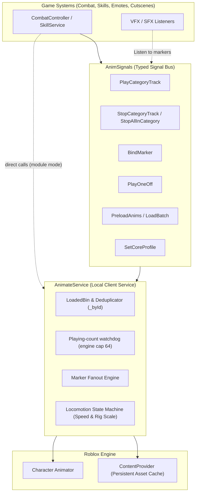
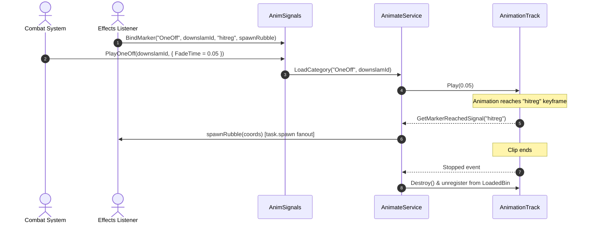

# Architecture & Data Flow

Everything funnels through one door. Your game never touches the `Animator` directly.



## The four boxes

**1. LoadedBin & Deduplicator (`_byId`)** — every combat track indexed by clean ID. Same ID under two categories shares one track. Never loaded twice per life. See [Core Concepts](concepts.md).

**2. Playing-count watchdog** — loading is free (200/200 `LoadAnimation` calls succeed). Playing is budgeted: the engine refuses past **64 active tracks** per `Animator`. The service warns past **48** (5s throttle) — headroom for anything else on the rig. OneOffs auto-destroy, death wipes the bin.

**3. Marker fanout** — one native connection per `(track, marker)`, N listeners via `task.spawn`. Hitbox + shake + SFX all hear `"hitreg"`.

**4. Locomotion state machine** — `Humanoid` state + speed → exactly one core track (`Idle`, `Walk`, `Run`, `Sprint`, `Jump`, `Fall`, `Climb`, `Swim`, `SwimIdle`, `Sit`). Speed dividends (`Walk/16`, `Run/18`, `Sprint/22`, `Climb/12`, `Swim/16`) and rig-scale normalisation included.

## Combat signal & marker flow



## Files

```text
Module/AnimateService       -- the engine (single implementation)
Services/AnimateService     -- launcher: Configure + Init + Start
Libraries/AnimSignals       -- 12 typed signals (the bus)
Libraries/Signal            -- SignalPlus v3.7.2, vendored
Tests/                      -- 9 proofs, run one at a time
```

`Module/AnimateService` *is* the implementation. `Services/AnimateService` only calls `Configure`, `Init`, `Start` on it. Mix signal fires and direct `require` calls freely — same code either way.
