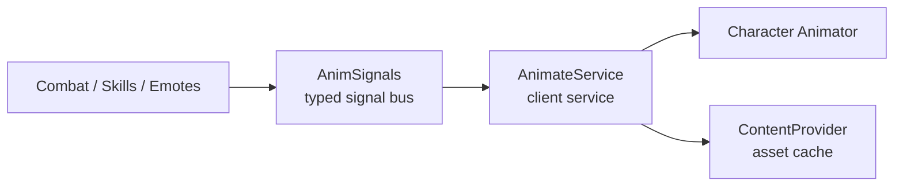

# AnimateService

**Stock `Animate` was built for obbies in 2014 — not high-speed anime combat.**

AnimateService completely takes over character animation. Your combat systems, skill movesets, emote wheels, cutscenes and downslams all talk to it through a typed signal bus (`AnimSignals`). No other script ever touches `Animator:LoadAnimation()` directly.



No other script loads animations. Ever. That's the whole deal.

## Why you'll love it

| The stock `Animate` trap | How AnimateService fixes it |
| :--- | :--- |
| **Blind `LoadAnimation` every swing** (leaked tracks) | **`LoadedBin` registry** — every track indexed by clean ID and reused |
| **First-swing frame hitch** (asset fetch mid-combo) | **System-side `PreloadAsync`** — first play and replays dispatch in ~0.1ms |
| **Marker callbacks dropped on cache hit** | **Marker fanout** — N systems listen to `Hit` / `CanCancel` on the same track |
| **Zero clean stop path** | **`StopCategoryTrack` & `StopAllInCategory`** — feints, interrupts, stuns cancel cleanly |
| **Tracks leak across lives** | **Per-life lifecycle** — old tracks die on death, asset cache stays warm |
| **Locomotion stomps combat arms** | **Caller-typed priority** — pass what each move needs, or clamp combat to `Action2`+ |
| **Default `Animate` fights your scripts** | **Instant suppression** — empty `StarterCharacterScripts/Animate` kills stock at the root |

Measured live in Play Solo (10-slot core): **10 tracks on spawn, 10 after respawn — never 20, never 38.** Cold fetch ~125.9ms, preloaded dispatch ~0.1ms.

## 60-second tour

1. Drop `Module/`, `Services/`, `Libraries/` into `StarterPlayerScripts`.
2. Delete stock `Animate` (empty `Animate` LocalScript suppresses it).
3. Fire a signal:

```luau
local AnimSignals = require(game.StarterPlayer.StarterPlayerScripts.Libraries.AnimSignals)

AnimSignals.PlayCategoryTrack:Fire("M1", "rbxassetid://123456789", {
    FadeTime = 0.05,
    Priority = Enum.AnimationPriority.Action2,
})
```

That's it. The track loads once, replays forever at 0.1ms, and dies cleanly with your character.

## Where to go next

New here? Follow the fun path:

[Quickstart](quickstart.md) → [Life of a Swing](life-of-a-swing.md) → [Combat Recipes](recipes.md)

Or jump around:

- [Architecture](architecture.md) — signal bus, LoadedBin, locomotion state machine
- [Priority & Partial-Body](priority.md) — why `Action` beats `Core` for combat arms
- [Signal Catalog](signals.md) — every signal, every payload
- [Module Mode](module-mode.md) — same engine, `require` instead of signals
- [Tests](tests.md) — 9 proofs you can run in Studio right now
