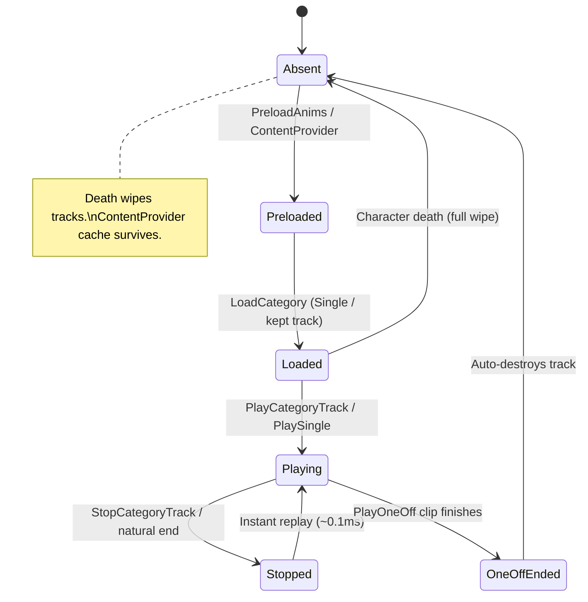

# Life of a Swing

Follow one M1 from button press to second swing. This is the mental model for everything else.

## Act 1: The press

You press LMB. Your `CombatController` doesn't touch the `Animator` — it fires a signal:

```luau
AnimSignals.PlayCategoryTrack:Fire("M1", M1_ID, {
    FadeTime = 0.05,
    Speed = 1.1,
    Priority = Enum.AnimationPriority.Action2,
})
```

`AutoPlay` defaults to `true` here. Pass `AutoPlay = false` and it only loads.

## Act 2: The lookup (three doors)

Inside `Rig:LoadCategory`, the service normalises your ID (`rbxassetid://123` ↔ `123`) and checks three doors in order:

1. **Same-bucket hit** — `M1/123` already loaded? Bump `Refs`, re-apply `Priority` / `Looped`, hook any `MarkerName`, `Play()` or `AdjustSpeed()`. Zero allocations.
2. **Cross-category share** — another system loaded `123` under `"Single"`? Alias the *exact same track* into `M1`. Never loaded twice per life.
3. **Fresh load** — `Instance.new("Animation")` + `Animator:LoadAnimation()` + register in both bucket and `_byId`. Then `Play(0.05)` and run the playing-cap watchdog.



## Act 3: The markers

Mid-swing your hitbox needs to fire exactly on the `"Hit"` keyframe. Somewhere else — maybe at startup, maybe right before the swing — someone bound it:

```luau
AnimSignals.BindMarker:Fire("M1", M1_ID, "Hit", function()
    DamageService:CastHitbox()
end)
```

The service keeps **one** native `GetMarkerReachedSignal("Hit")` connection and fans out to every listener via `task.spawn`. Hit detection, screen shake, sound and particles can all hook the same marker independently. It survives reuse because the listener lives on the track entry, not the load call.

## Act 4: The feint

You press Q to dash-cancel mid-windup:

```luau
AnimSignals.StopCategoryTrack:Fire("M1", M1_ID, 0.05)
```

Omit the ID and the whole `M1` bucket stops. Got parried instead? Nuke it:

```luau
AnimSignals.StopAllInCategory:Fire({ Category = "M1", Fade = 0.05 })
```

Kept Singles stay in the bin after stop — replay is instant. OneOffs (`PlayOneOff`) are different: they `Destroy()` themselves the moment `Stopped` fires. Fire-and-forget.

## Act 5: The second swing

You swing again. Same ID, same bucket. Door #1 hits. Track count stays flat:

```text
[Validator] PASS single reuse second load flat -- before 10 mid 11 after 11
```

First load `10 → 11`. Second load `11 → 11`. That's dedup working.

## Act 6: Death

You die. Every track on your old `Animator` is now a dead instance (`Parent == nil`). Calling `:Play()` on one fails **silently** — no error, just nothing. That's the stale-reference trap.

So don't hold tracks. Dispatch by ID every time:

- **Remembered across lives:** loaded profiles, active core (unless `PersistProfiles = false`), preload cache.
- **Forgotten:** tracks, marker listeners, active overlay (definition remembered — just re-arm it).

Respawn rebuilds your 10 core tracks warm in under a millisecond, because `ContentProvider` still has the bytes:

```text
[PartialTest] same id dispatches in 0.1ms after respawn (content cached, only the track is new)
```

## The one-sentence version

> **Preload like you mean it, dispatch by ID, never hoard tracks past death.**

Next: [Priority & Partial-Body](priority.md) — why your block needs `Action`, not `Core`.
