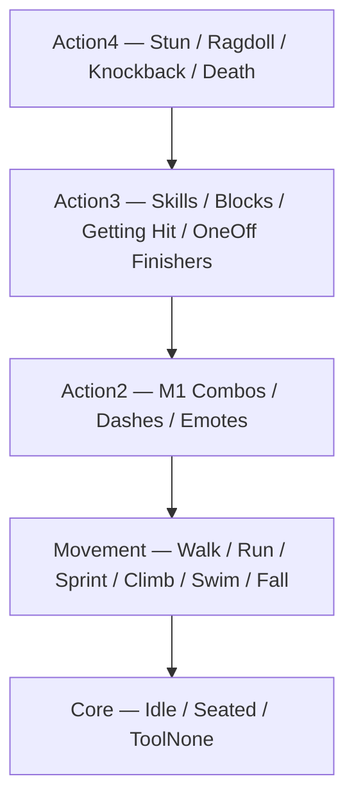

# Priority & The Partial-Body Rule

Roblox blends animations **per joint, high to low**. Each joint adds weights top-down until the sum hits `1.0` — then lower tracks are skipped for that joint.

Same priority blends by weight (normalised past 1.0). Two `Core` tracks on one joint average out instead of one winning — that's the "hiccup".



## The table (pin this)

| Enum | Value | Typical usage |
| :--- | :---: | :--- |
| `Idle` | 0 | Character idle |
| `Movement` | 1 | Walk, run, swim, climb, locomotion |
| `Action` | 2 | Actions overriding idle + locomotion |
| `Action2` | 3 | Overrides `Action` (M1s, dashes, emotes) |
| `Action3` | 4 | Overrides `Action2` (skills, blocks, hits, OneOffs) |
| `Action4` | 5 | Highest (stun, ragdoll, death) |
| `Core` | 1000 | **Lowest** — default when `Priority` is omitted |

!!! warning "Core looks big, acts small"
    `Core = 1000` reads like the highest number. The engine treats it as the **lowest** priority. Omit `Priority` and your combat clip loads at `Core` — underneath locomotion. That's almost never what you want for a swing.

## The Deepwoken rule

**Hands at `Action2+`, legs free.**

Make `blocking` or `m1_combo1` with keyframes **only** on upper torso, arms and head. Leave lower torso and legs **unkeyed**. Unkeyed joints fall through — legs keep playing whatever runs below.

Eyeball test from `AnimPartialTest` (run it yourself with WASD):

- `blocking` at **`Action`** — run around, legs sprint freely, arms locked in guard. Correct!
- `blocking` at **`Core`** — locomotion fights the guard, glitchy jittering mess. Wrong!

> Guidance (measured): hands-only clips look right *above* locomotion and wrong *at* its level. Pass `Action`+ for combat.

## How the service applies it

By default the service assigns **nothing** to category tracks: omitted `Priority` loads at `Core`. Pass any `Enum.AnimationPriority` and it loads at that instead.

A combat game that keeps combat above locomotion:

```luau
AnimateService:Configure({
    LocomotionPriority = Enum.AnimationPriority.Movement,
    ClampCombatPriority = true, -- force combat to Action2+
    DefaultOverlayPriority = Enum.AnimationPriority.Action,
})
```

With `ClampCombatPriority = true`, category tracks may only be `Action2`–`Action4`. Anything lower (including `Core` or `nil`) becomes `MinCombatPriority` (`Action2`).

!!! tip "Locomotion at Movement"
    Default locomotion loads at `Core`. Set `LocomotionPriority = Movement` and stray `Core` clips stop stomping your walk cycle. The stack diagram above assumes you did.
